# x

One command list for a repository, in one file. `x.toml`
declares the commands; `x <command>` runs them, a generated
Makefile makes `make <command>` run the same thing, and a
coding agent reads the same list as JSON.

```sh
npx @tryc.ai/x init     # write a starter x.toml
npx @tryc.ai/x help     # list the commands
npx @tryc.ai/x hello    # run the starter's one command
```

```toml
# x.toml
[x]
version = "0.1.0"

[commands.test]
description = "Run the test suite."
run = ["pytest", "-q"]

[commands.lint]
description = "Check formatting."
bash = "tools/lint.sh"

[make]
default = "test"
```

It needs Node 18 or newer, for `npx`, and Python 3.11 or
newer, which runs the engine. If `python3` is older than
that, x also tries `python3.13`, `python3.12`, `python3.11`,
`python3.14` and `python` (on Windows: `py -3`, `python`,
`python3`), and `X_PYTHON` names an interpreter outright.
With none found it says what it tried and exits 127.

<picture>
  <source
    media="(prefers-reduced-motion: reduce)"
    srcset="assets/poster.svg"
  />
  
</picture>

The image is drawn from a recorded session,
[`evidence/transcripts/session.txt`](evidence/transcripts/session.txt).
It shows the command-line tool, called as `x`, which is what
`npm install --global @tryc.ai/x@0.1.0` gives you; read it
as `npx @tryc.ai/x` otherwise. The fourth command sets
`launcher = "x"` so that the Makefile calls that installed
`x`; leave the line out and the Makefile calls
`npx --yes @tryc.ai/x@0.1.0`. The image does not show an
agent following the skill.

**Not measured, stated up front.**

- The animated demo is a scripted tool session. A separate
  Codex skill exercise is recorded below. Claude execution
  was rejected by its session rate limit; live GitHub
  installs remain unverified.
- The 259-test suite passed on macOS with Python 3.11, 3.12
  and 3.13 and Node 26, and on Linux with Python 3.11.2 and
  Node 18.20.8 (one process-replacement test skipped). An
  earlier 257-test revision passed on Linux with Python 3.12
  and 3.13 and Node 24. It was not run on Windows.
- On Windows a `bash` handler is sent through WSL. The tests
  check the command line x builds for that and do not start
  WSL.
- `engines` in `package.json` says Node 18 or newer. The
  launcher was run on Node 18.20.8 and 26; an earlier
  revision was run on Node 24. Node 18 exercises the relay
  path because it cannot replace the running process. That
  path is also tested on Node 26 by hiding that ability.
- `resume` is tested against folders laid out the way six
  coding agents store their sessions. It was not tested
  against those agents themselves, and the arguments x
  appends to resume each one were not checked against the
  agents' current releases.
- How long x takes to start was not measured.

## What it does

- **Dispatches.** `x test -k slow` runs `pytest -q -k slow`.
  Arguments, streams and the exit status pass through
  unchanged, and a command ended by a signal ends x by the
  same signal (the reference lists the exceptions, which
  arise on older Node versions). On macOS and Linux no
  handler goes through a shell; see [Windows](#windows) for
  the exception.
- **Generates the Makefile.** `x makefile` writes one target
  per command. `x makefile --check` exits 1 when the file is
  stale, so CI can refuse a Makefile that has drifted from
  `x.toml`.
- **Scopes commands to folders.** A folder can carry its own
  `x.toml` that adds or replaces commands for itself and
  everything below it.
- **Describes itself.** `x help --json` reports every
  command's name, description and aliases, its handler type
  and working-directory setting, and the file that declares
  it.
- **Pins its own version.** `[x] version` is exact. A
  different x re-runs the pinned one.
- **Resumes agent sessions.** `x resume <id>` finds which of
  six coding agents recorded a session and restarts it,
  through a launcher you configure, in the folder the
  session recorded when it recorded one.

## What it is not

It is not a build system: there are no dependencies between
commands, no caching and no file targets. It runs the tools
you already have, by name. If a command needs to do three
things, point it at a script that does them.

## `x.toml`

A command needs a `description` and one handler:

| Handler   | Runs                                                 |
| --------- | ---------------------------------------------------- |
| `run`     | An argv, exactly as written.                         |
| `bash`    | A script, with optional `args`. On Windows, via WSL. |
| `npx`     | An argv after `npx`.                                 |
| `bazel`   | An argv after Bazelisk.                              |
| `builtin` | One of x's own commands, under your name for it.     |

```toml
[commands.deploy]
description = "Deploy the site."
aliases = ["d"]
platforms = ["linux", "macos"]
run = ["tools/deploy.sh", "--env", "prod"]
cwd = "root"

[commands.deploy.env]
DEPLOY_ROOT = "{root}"
```

A script named with a path, like `tools/deploy.sh` here, has
to be executable and start with a `#!` line; otherwise x
says so and exits 126.

A repository that already has a dispatcher can adopt x
without rewriting it. `[defaults]` gives every command that
has no handler of its own the same one, and `[unknown]`
hands over anything `x.toml` does not declare:

```toml
[defaults]
bash = "tools/cli.sh"
args = ["{name}"]

[unknown]
bash = "tools/cli.sh"

[commands.build]
description = "Build everything."

[commands.test]
description = "Run the tests."
```

Every key is in [docs/reference.md](docs/reference.md).

## Which `x.toml` applies

```text
x.toml            root file: has an [x] table
web/x.toml        folder file: [commands.*] only
```

Inside a Git repository, x looks from the working directory
up to the repository's top folder and no further. Inside
`web/`, the commands in `web/x.toml` exist too, run with
`web/` as their working directory, and win over a root
command of the same name. Outside `web/` they do not exist.

In a folder that is in no Git repository, x reads an
`x.toml` in that folder only. A file in a folder above it
never applies.

## The Makefile

With a `[make]` table, `x makefile` writes:

```make
# Generated by x from x.toml. Do not edit by hand.

X := npx --yes @tryc.ai/x@0.1.0
ARGS ?=
.DEFAULT_GOAL := test

.PHONY: test
test:
	@$(X) test $(ARGS)

.PHONY: lint
lint:
	@$(X) lint $(ARGS)
```

so `make test ARGS="-k slow"` and `x test -k slow` are the
same run. A command can replace its recipe, stay out of the
Makefile, or add lines around its target; `[make] header`
replaces the header when a repository needs its own. x will
not overwrite a Makefile it did not generate unless you pass
`--force`.

## Built-in commands

| Command    | Does                                             |
| ---------- | ------------------------------------------------ |
| `help`     | Lists commands. `--json` for tools.              |
| `version`  | Prints the running version.                      |
| `check`    | Validates the `x.toml` files and the Makefile.   |
| `init`     | Writes a starter `x.toml`. Never overwrites.     |
| `makefile` | Writes the Makefile, or compares with `--check`. |
| `resume`   | Resumes a coding-agent session by id.            |

Once a repository has an `x.toml`, `help` lists its commands
only; `help --all` adds these. A command of your own with
the same name wins, and `x --builtin <name>` always reaches
the built-in. `check` covers the files that apply where it
is run and every `x.toml` Git tracks under the root.

## Windows

Before this release x was not run on Windows; this is what
the code does there.

- A `bash` handler runs through `wsl.exe`.
- A program that is a `.cmd` or `.bat` file is run by
  Windows through `cmd.exe`. That covers `npx` and `npm`, so
  it covers the `npx` and `bazel` handlers and the re-run of
  a pinned version. `cmd.exe` gives `&`, `|`, `^` and
  `%NAME%` a meaning inside arguments, so on Windows the
  statement that arguments reach the program untouched does
  not hold for those programs.

## Names on npm

The publisher holds four npm scopes and publishes the same
files under each, so any of these names runs the same tool.
The generated Makefile and the re-run of a pinned version
always use `@tryc.ai/x`.

```text
@tryc.ai/x    @trycopilotai/x    @trycopilot.ai/x    @trycai/x
```

To skip `npx` on every run, install it once and call `x`:

```sh
npm install --global @tryc.ai/x@0.1.0
```

## Agent skill

The repository is also an agent skill that teaches a coding
agent to use x in a repository that has an `x.toml`: find
the pinned version, list commands from `help --json`, run
them, and add or change one without hand-editing the
generated Makefile.

Both installs pin `v0.1.0`. Each block can be run twice with
the same result, stops at the first step that fails, and
refuses to replace anything at the skill's path that it did
not put there.

The blocks were run against a local copy of this repository,
not against GitHub. There, the first run of each printed one
line, `warning: refs/tags/v0.1.0 … is not a commit!`, which
is what git says when it clones at an annotated tag. The
second run printed nothing.

To remove the skill, delete the link and the checkout the
block names. A block for a later release refuses to replace
this release's link, so remove the link first.

### Claude Code

```sh
(
  set -eu
  release=v0.1.0
  checkout="$HOME/.claude/plugins/x-$release"
  discovery="$HOME/.claude/skills/x"
  mkdir -p "$(dirname "$checkout")" "$(dirname "$discovery")"
  if [ -d "$checkout/.git" ]; then
    git -C "$checkout" fetch --quiet --depth 1 origin tag \
      "$release"
  else
    git -c advice.detachedHead=false clone --quiet --depth 1 \
      --branch "$release" https://github.com/trycopilotai/x \
      "$checkout"
  fi
  git -C "$checkout" -c advice.detachedHead=false checkout \
    --quiet --detach "$release"
  if [ -L "$discovery" ]; then
    if [ "$(readlink "$discovery")" != "$checkout/skill" ]; then
      echo "Refusing to replace another link: $discovery" >&2
      exit 1
    fi
  elif [ -e "$discovery" ]; then
    echo "Refusing to replace non-symlink: $discovery" >&2
    exit 1
  fi
  ln -sfn "$checkout/skill" "$discovery"
)
```

Then invoke the standalone skill:

```text
/x what commands does this repository have?
```

Installed as a plugin from a marketplace that lists it, the
skill is namespaced:

```text
/x:x add a lint command
```

### Codex

```sh
(
  set -eu
  release=v0.1.0
  checkout="$HOME/.codex/plugins/x-$release"
  discovery="$HOME/.agents/skills/x"
  mkdir -p "$(dirname "$checkout")" "$(dirname "$discovery")"
  if [ -d "$checkout/.git" ]; then
    git -C "$checkout" fetch --quiet --depth 1 origin tag \
      "$release"
  else
    git -c advice.detachedHead=false clone --quiet --depth 1 \
      --branch "$release" https://github.com/trycopilotai/x \
      "$checkout"
  fi
  git -C "$checkout" -c advice.detachedHead=false checkout \
    --quiet --detach "$release"
  if [ -L "$discovery" ]; then
    if [ "$(readlink "$discovery")" != "$checkout/skill" ]; then
      echo "Refusing to replace another link: $discovery" >&2
      exit 1
    fi
  elif [ -e "$discovery" ]; then
    echo "Refusing to replace non-symlink: $discovery" >&2
    exit 1
  fi
  ln -sfn "$checkout/skill" "$discovery"
)
```

Then invoke it:

```text
$x what commands does this repository have?
```

Installed as a plugin from a Codex marketplace that lists
it, use `@x`.

## Evidence

[`evidence/transcripts/session.txt`](evidence/transcripts/session.txt)
is a terminal session recorded by
`scripts/record_session.py`: eight commands, run in order in
an empty throwaway folder. The script wrote each line that
starts with `$ `, which is the command it ran. Every other
line is what that command printed. Nothing was edited.

[`evidence/demo-manifest.json`](evidence/demo-manifest.json)
lists the commands, the date, the Python and Node versions,
and the SHA-256 of the transcript, of the skill, and of
every file of the tool. It also records that no agent
invoked the skill.

`assets/demo.svg` and `assets/poster.svg` are generated from
the transcript by `scripts/generate_demo.py`, and
`scripts/verify_demo.py` checks them against it.

The test suite holds these together. It recomputes every
hash in the manifest, runs the session again and compares
the output with the transcript line for line, re-renders
both images, and checks the social preview against its
stamp.

This scripted demo records the tool on the machine that
recorded it. The separate agent exercise below records Codex
following `SKILL.md`.

### Actual agent exercise

The fixtures in `evidence/fixtures/` are synthetic. Codex
CLI 0.162.1 read the skill, discovered the pinned commands,
ran `hello "two words"`, added `greet`, regenerated the
Makefile through x, ran `greet friend` directly and through
Make, and checked configuration and Makefile freshness. The
local launcher was `node bin/x.js`; no npm publication was
needed. Two earlier runs read the repository-local skill and
repeated command discovery, dispatch and checks without
editing files. Their transcripts do not establish
marketplace plugin selection or the invocation form.

[`evidence/agent-manifest.json`](evidence/agent-manifest.json)
binds the input commit, skill, fixture bytes and
transcripts.
[`codex-skill.jsonl`](evidence/transcripts/codex-skill.jsonl)
[`codex-discovery.jsonl`](evidence/transcripts/codex-discovery.jsonl)
and
[`codex-plugin.jsonl`](evidence/transcripts/codex-plugin.jsonl)
are native event streams with local absolute paths replaced
by fixture paths. They are edited transcripts; no command
outputs or agent steps were synthesized. Raw streams and the
ordered redaction chain are retained privately for the
release reviewers.

The evidence tests replay the recorded commands against the
recorded output configuration and compare the generated
Makefile byte for byte. They do not rerun an agent or prove
that another agent will produce the same result.

## Development

```sh
make test             # the suite, through x itself
make pack             # list what the npm package would ship
make record           # record the evidence session again
make demo             # rebuild the demo and poster from it
make social-preview   # render the social preview (needs Chrome)
```

The repository runs on its own `x.toml`; its Makefile is
generated. The suite needs Python 3.11 or newer, Node, and
nothing from PyPI or npm.

See [CONTRIBUTING.md](CONTRIBUTING.md) and
[SECURITY.md](SECURITY.md).

## License

MIT license. See [LICENSE](LICENSE).
